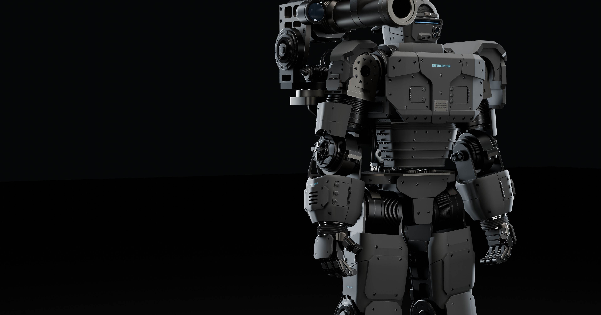
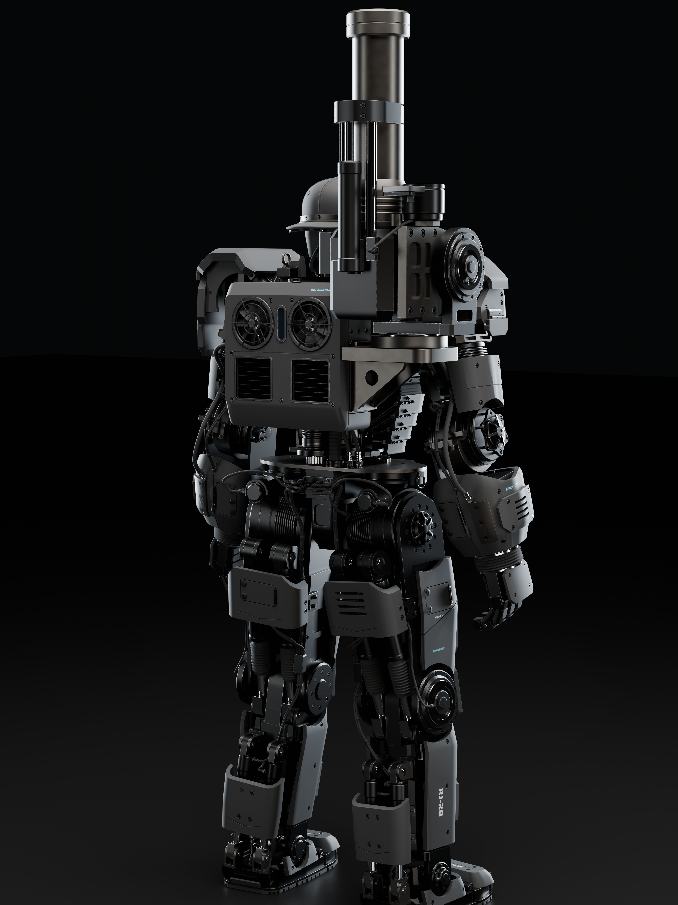
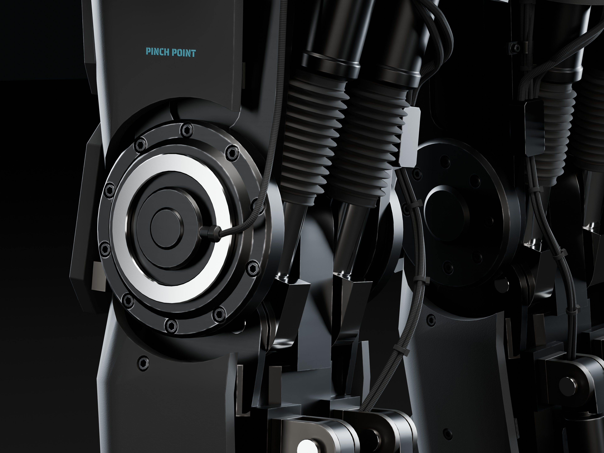
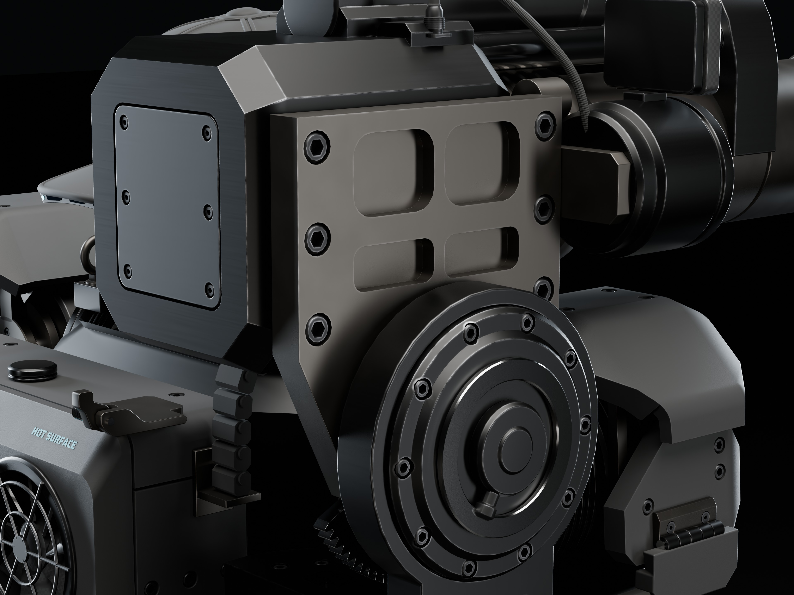

# RJ-28 Interceptor



**Live site: https://bouwles.github.io/rj-28-interceptor/**

A fictional machine presented as a real engineering project: a 173 cm autonomous humanoid interceptor, built heavy, all black, with a hard-shell backwards cap and one thick cannon that stands behind its right shoulder and swings down to fire forward.

The robot is modelled entirely by Python scripts run in Blender: 927 named parts in 17 assemblies, 46 degrees of freedom, 185 kg. Every dimension, mass and drawing on the site is measured from that model, not typed in.

## What the site does

- **Model.** The whole robot in real-time 3D. Stow and deploy the cannon, train it in traverse and elevation, take the armour off layer by layer down to the frame and actuators, explode it by assembly and by part, pick any part to read its number, function, material and mass.
- **Blueprints.** Five orthographic drawing sheets generated from the model with hidden-line removal: general arrangement, head and cap, cannon and mount, leg mechanism, exploded isometric. Also as a [PDF set](site/public/drawings/RJ28-GA-set.pdf).
- **Specification.** Principal data, all 46 joints, the mass roll-up, and three worked design notes (knee torque, endurance, mass).

| | |
|---|---|
|  |  |
|  |  |

## How it was made

1. **Procedural model.** `blender/rj28/` builds every part with `bmesh` from the dimensions in `params.py`. Each part has a number, a function, a material and something it attaches to. Bevels are live modifiers; booleans are applied at build time.
2. **Checks.** The mount is swept through its whole travel and must clear the body by 15 mm (it clears by 18). A contact check lists parts that float or sink into each other. Mass is rolled up from mesh volumes.
3. **Measured data.** `measure.py` writes `spec.json` and `parts.json` from the mesh. The site and the drawings read only those.
4. **Drawings.** `drawings.py` projects feature and silhouette edges orthographically, removes hidden lines by ray casting, and writes SVG sheets with dimensions taken from the data.
5. **Renders and web models.** Cycles hero renders in a studio rig; `export.py` writes two levels of detail and an edge-line model as compressed glTF.
6. **Site.** Vite, TypeScript and three.js. Static, hosted on GitHub Pages.

## Rebuild

Requires Blender 4.4 and Node 24.

```
blender --background --python blender/build.py -- model noctx sweep measure write hero scale=1.0 samples=192
blender --background --python blender/build.py -- export all
npm --prefix tools/gltf ci && node tools/gltf/optimize.mjs && node tools/gltf/verify.mjs
blender --background --python blender/build.py -- drawings
npm --prefix site ci && npm --prefix site run build
```

## Layout

| Path | Contents |
|---|---|
| `blender/rj28/params.py` | Every design dimension, in millimetres |
| `blender/rj28/lib/` | Modelling toolkit: plates, fasteners, bearings, gears, actuators, harness, fittings |
| `blender/rj28/assemblies/` | One module per assembly |
| `blender/rj28/measure.py`, `export.py`, `drawings.py` | Measured data, web models, drawing sheets |
| `site/` | The website |
| `docs/DESIGN.md` | Design bible |
| `docs/DECISIONS.md` | One line per decision |
| `docs/BUILD_LOG.md` | What happened in each phase |

## Credits

See [CREDITS.md](CREDITS.md).

Concept design. Fictional system. Design and build: Paul Nercessian.
