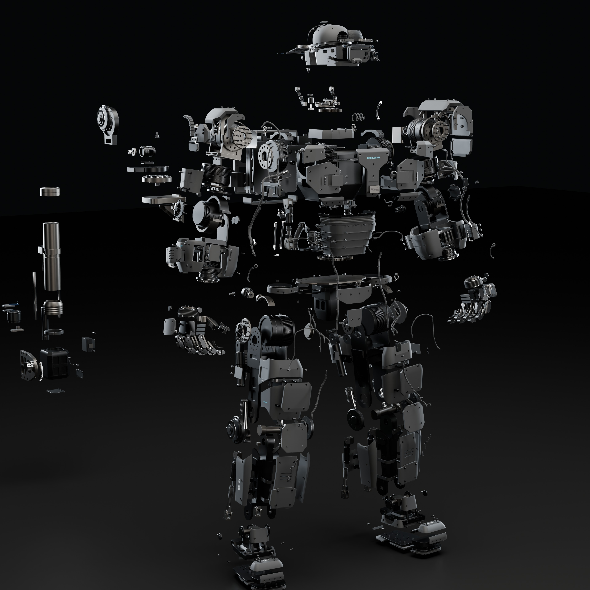

# RJ-28 Interceptor

**Live site: https://bouwles.github.io/rj-28-interceptor/**

A 173 cm autonomous humanoid interceptor, built heavy, all black, with a hard-shell backwards cap and one thick cannon that stands behind its right shoulder and swings down to fire forward.

927 named parts in 17 assemblies, 46 degrees of freedom, 185 kg. Every dimension, mass and drawing on the site is measured from that model, not typed in.

## What the site does

- **Model.** The whole robot in real-time 3D. Stow and deploy the cannon, train it in traverse and elevation, take the armour off layer by layer down to the frame and actuators, explode it by assembly and by part, pick any part to read its number, function, material and mass. Animations run on the real joints with the actuators working, armour on or off: look around, function check, squat, wave, fist bump, fist to palm, and an intercept with the cannon.
- **Blueprints.** Five orthographic drawing sheets generated from the model with hidden-line removal: general arrangement, head and cap, cannon and mount, leg mechanism, exploded isometric. Also as a [PDF set](site/public/drawings/RJ28-GA-set.pdf).
- **Specification.** Principal data, all 46 joints, the mass roll-up, and three worked design notes (knee torque, endurance, mass).

| | |
|---|---|
|  |  |
|  |  |

## Credits

See [CREDITS.md](CREDITS.md).

Design and build: Paul Nercessian.
