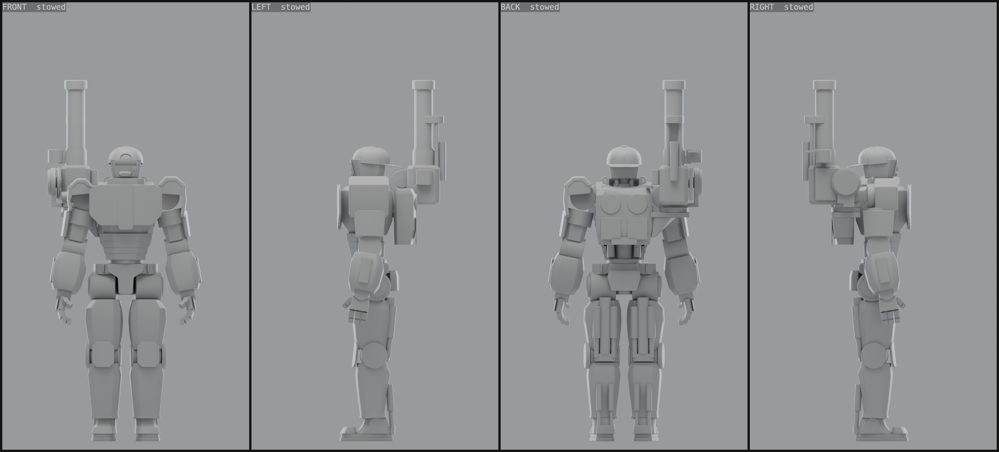

# RJ-28 INTERCEPTOR

An interactive engineering dossier for a fictional machine: a 173 cm autonomous humanoid interceptor, built heavy, all black, with a hard-shell backwards cap and one thick cannon that stands behind its right shoulder and swings down to fire forward.

The robot is modelled entirely by Python scripts run in Blender. Dimensions, masses and drawings shown on the site are measured from that model, not typed in.

**Status: in build.** The proportional blockout is done and under review. Detailed modelling, materials, drawings and the website follow.



## Rebuild

Requires Blender 4.4.

```
blender --background --python blender/build.py -- testboard
blender --background --python blender/build.py -- blockout
```

Outputs go to `blender/out/` and review renders to `docs/review/`.

## Layout

| Path | Contents |
|---|---|
| `blender/rj28/params.py` | Every design dimension, in millimetres |
| `blender/rj28/lib/` | Modelling toolkit: plates, fasteners, bearings, gears, actuators, harness, fittings |
| `blender/rj28/assemblies/` | One module per assembly |
| `docs/DESIGN.md` | Design bible |
| `docs/DECISIONS.md` | One line per decision |
| `docs/BUILD_LOG.md` | What happened in each phase, with render paths |

## Credits

See [CREDITS.md](CREDITS.md).

Concept design. Fictional system. Design and build: Paul Nercessian.
